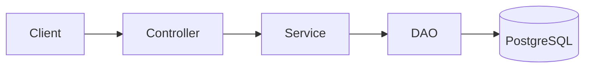
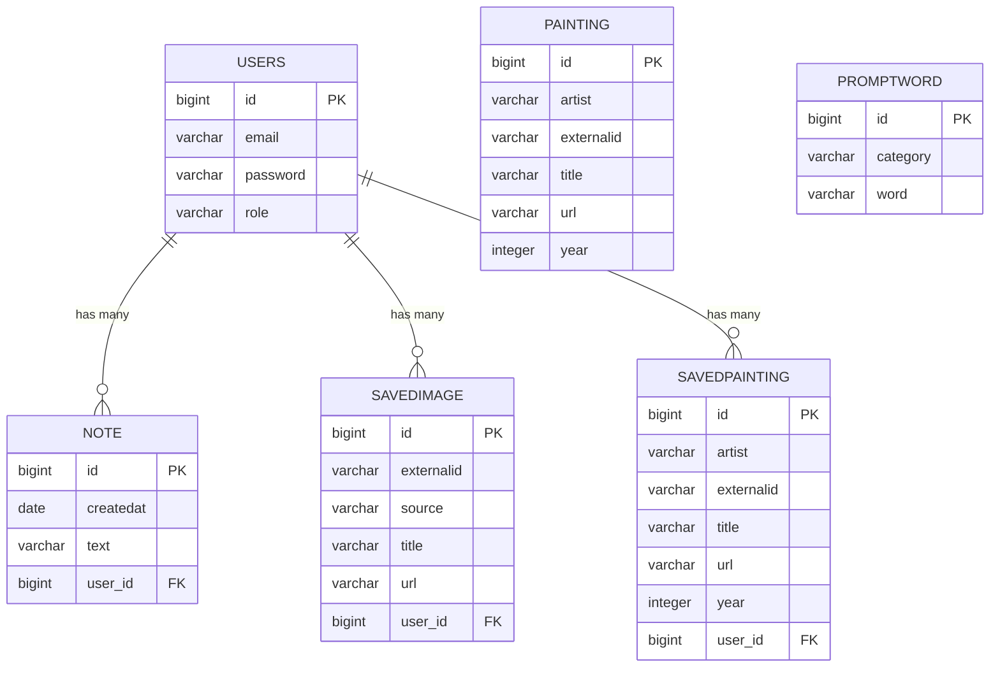

# ArtPrompt


## Vision

> ArtPrompt is a backend API that fetches paintings from the Rijksmuseum API, lets users  fetch ten images from the Unsplash API from a color category
>  or get random words from categories. Users can save paintings and images to their own collection and also make notes.


---

## Links

Portfolio website:
https://stinetorndal.github.io/portfolio_DAT3_2026/

Deployed application:
https://www.torndalchristensen.dk/

Source code repository:
https://github.com/stinetorndal/ArtPrompt

---

# Architecture

## System Overview

The project is a layered backend:

- Controller layer (REST endpoints, Javalin)
- Service layer (business logic, external API calls)
- DAO layer (database access via JPA / Hibernate)

Technologies used:

- Java 25
- Javalin
- JPA / Hibernate with HikariCP
- PostgreSQL
- Maven
- JWT authentication
- Docker
- GitHub Actions (CI/CD)
- Hosted on Hetzner

## Architecture Diagram



## Key Design Decisions

**Authentication**

Users log in at `/api/v1/auth/login` and receive a JWT. The token must be sent as
`Authorization: Bearer <token>` on protected endpoints. Tokens expire after 6 hours.

**Configuration and secrets**

Database credentials and the JWT secret  are read from
environment variables (GitHub Secrets in CI, environment variables on the server),
with `config.properties` as a local fallback.

**Separate test database**

Integration tests run against a separate `<db>_test` database that is recreated on every test run.

**CI/CD**

On every push, GitHub Actions starts a PostgreSQL container, runs the tests, builds the
project and pushes a Docker image to Docker Hub.

**Parallel fetching**

Paintings are fetched from the Rijksmuseum API in parallel using multiple threads.

---

# Data Model

## ERD

## 🗄️ Database Structure & ERD

Below is the Entity Relationship Diagram (ERD) and table overview for the **ArtPrompt** PostgreSQL database.

### ER Diagram (Mermaid)



---

### 📋 Table Descriptions

#### 1. `users`
Registered user credentials and roles.
| Column | Type | Constraints | Description |
| :--- | :--- | :--- | :--- |
| `id` | `bigint` | Primary Key, Identity | Unique user identifier |
| `email` | `varchar(255)` | Not Null | User login email |
| `password` | `varchar(255)` | Not Null | Hashed password |
| `role` | `varchar(255)` | Not Null | User authorization role (`USER`, `ADMIN`) |

#### 2. `note`
User-created personal notes.
| Column | Type | Constraints | Description |
| :--- | :--- | :--- | :--- |
| `id` | `bigint` | Primary Key, Identity | Unique note identifier |
| `createdat` | `date` | | Date the note was created |
| `text` | `varchar(255)` | | Content of the note |
| `user_id` | `bigint` | Foreign Key (`users.id`) | Owner of the note |

#### 3. `savedimage`
Unsplash/external inspiration images saved by a registered user.
| Column | Type | Constraints | Description |
| :--- | :--- | :--- | :--- |
| `id` | `bigint` | Primary Key, Identity | Unique record ID |
| `externalid` | `varchar(255)` | | ID from external provider (e.g., Unsplash) |
| `source` | `varchar(255)` | | Origin API/Source |
| `title` | `varchar(255)` | | Title or prompt description |
| `url` | `varchar(255)` | | Direct image URL |
| `user_id` | `bigint` | Foreign Key (`users.id`) | User who saved the image |

#### 4. `savedpainting`
Rijksmuseum paintings saved by a registered user.
| Column | Type | Constraints | Description |
| :--- | :--- | :--- | :--- |
| `id` | `bigint` | Primary Key, Identity | Unique record ID |
| `artist` | `varchar(255)` | | Artist name |
| `externalid` | `varchar(255)` | | Unique museum ID |
| `title` | `varchar(255)` | | Title of the painting |
| `url` | `varchar(255)` | | High-res image URL |
| `year` | `integer` | | Year created |
| `user_id` | `bigint` | Foreign Key (`users.id`) | User who saved the painting |

#### 5. `painting` *(Lookup Table)*
General repository of cached museum paintings available for random inspiration queries (anonymous & public access).
| Column | Type | Constraints | Description |
| :--- | :--- | :--- | :--- |
| `id` | `bigint` | Primary Key, Identity | Unique record ID |
| `artist` | `varchar(255)` | | Artist name |
| `externalid` | `varchar(255)` | | Unique museum ID |
| `title` | `varchar(255)` | | Title of the painting |
| `url` | `varchar(255)` | | Image URL |
| `year` | `integer` | | Year created |

#### 6. `promptword` *(Lookup Table)*
Standalone word pool categorized for prompt generation.
| Column | Type | Constraints | Description |
| :--- | :--- | :--- | :--- |
| `id` | `bigint` | Primary Key, Identity | Unique record ID |
| `category` | `varchar(255)` | | Category enum string (e.g., `STYLE`, `SUBJECT`) |
| `word` | `varchar(255)` | | Prompt word |


---

# API Documentation

Base URL: `http://torndalchristensen.dk:7070/api/v1`

Protected endpoints require the header `Authorization: Bearer <token>`.


### Log in

```
POST /auth/login
```

Request body:

```json
{ "email": "user@example.com", "password": "secret" }
```

Response: `200 OK` with a JWT token.


### Get a user's saved paintings

```
GET /paintings/user/{userId}
Authorization: Bearer <token>
```

Response (example):

```json
{ "externalId": "SK-C-5", "title": "Nattevagten", "artist": "Rembrandt van Rijn", "userId": 1 }
```

### Get a user's saved images

```
GET /images/user/{userId}
Authorization: Bearer <token>
```

TODO: add the remaining endpoints (register, save painting/image, delete, prompts, etc.)
and mark which ones require the ADMIN role.

---

# User Stories

TODO

---

# Development Notes

- Setting up CI with a PostgreSQL service container and separate test database
- Handling secrets with environment variables instead of hardcoding
- Parallel fetching from an external API

---

# License

This project is licensed under the GNU General Public License v3.0. See [LICENSE](LICENSE) for details.
