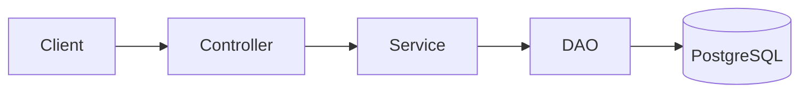
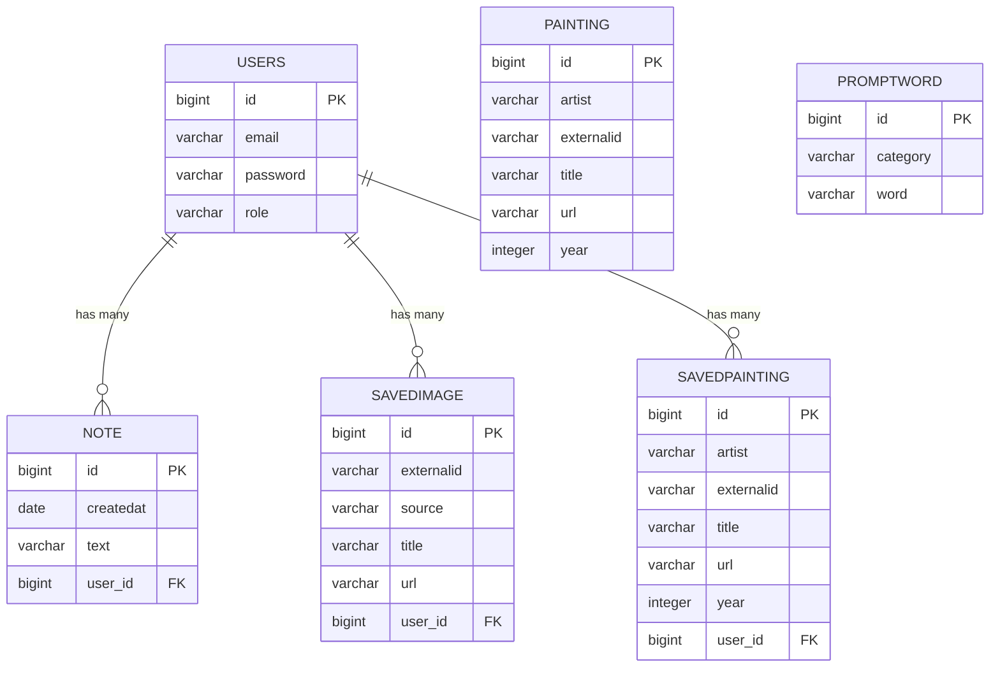

# ArtPrompt


## Vision

> ArtPrompt is a backend API that fetches paintings from the Rijksmuseum API, lets users  fetch ten images from the Unsplash API from a color category
>  or get random words from categories. Users can save paintings and images to their own collection and also make notes.


---

## Links

Portfolio website:
https://stinetorndal.github.io/portfolio_DAT3_2026/

Deployed application:
https://torndalchristensen.dk

Source code repository:
https://github.com/stinetorndal/ArtPrompt

Route overview (all endpoints):
https://torndalchristensen.dk/api/v1/routes

---

# Architecture

## System Overview

The project is a layered backend:

- Controller layer (REST endpoints, Javalin)
- Service layer (business logic, external API calls)
- DAO layer (database access via JPA / Hibernate)

Technologies used:

- Java 25
- Javalin
- JPA / Hibernate with HikariCP
- PostgreSQL
- Maven
- JWT authentication
- Docker
- GitHub Actions (CI/CD)
- Hosted on Hetzner

## Architecture Diagram



## Key Design Decisions

**Authentication**

Users log in at `/api/v1/auth/login` and receive a JWT. The token must be sent as
`Authorization: Bearer <token>` on protected endpoints. Tokens expire after 6 hours.

**Configuration and secrets**

Database credentials and the JWT secret  are read from
environment variables (GitHub Secrets in CI, environment variables on the server),
with `config.properties` as a local fallback.

**Separate test database**

Integration tests run against a separate `<db>_test` database that is recreated on every test run.

**CI/CD**

On every push, GitHub Actions starts a PostgreSQL container, runs the tests, builds the
project and pushes a Docker image to Docker Hub.

**Parallel fetching**

Paintings are fetched from the Rijksmuseum API in parallel, with one task per artist. The number of threads can be set per request with `?threads=` (1 to 8, default 4). Only one fetch can run at a time.

Measured on the deployed server (Hetzner), total time for fetching all artists (181 paintings):

| Threads | Total time | Compared to 2 threads |
|:-------:|-----------:|:----------------------|
| 2       | 5541 ms    | baseline              |
| 4       | 2866 ms    | 1.9x faster           |
| 6       | 2673 ms    | 2.1x faster           |
| 8       | 1771 ms    | 3.1x faster           |

Each setting was run once, and network speed varies between runs. For example, earlier runs with 4 threads took between 2866 and 4110 ms. The difference between 4 and 6 threads is therefore within the noise, while the difference between 2 and 8 threads is clear. The upper limit of 8 threads protects the Rijksmuseum API.

---

# Data Model

## ERD

## 🗄️ Database Structure & ERD

Below is the Entity Relationship Diagram (ERD) and table overview for the **ArtPrompt** PostgreSQL database.

### ER Diagram (Mermaid)



---

### 📋 Table Descriptions

#### 1. `users`
Registered user credentials and roles.
| Column | Type | Constraints | Description |
| :--- | :--- | :--- | :--- |
| `id` | `bigint` | Primary Key, Identity | Unique user identifier |
| `email` | `varchar(255)` | Not Null | User login email |
| `password` | `varchar(255)` | Not Null | Hashed password |
| `role` | `varchar(255)` | Not Null | User authorization role (`USER`, `ADMIN`) |

#### 2. `note`
User-created personal notes.
| Column | Type | Constraints | Description |
| :--- | :--- | :--- | :--- |
| `id` | `bigint` | Primary Key, Identity | Unique note identifier |
| `createdat` | `date` | | Date the note was created |
| `text` | `varchar(255)` | | Content of the note |
| `user_id` | `bigint` | Foreign Key (`users.id`) | Owner of the note |

#### 3. `savedimage`
Unsplash/external inspiration images saved by a registered user.
| Column | Type | Constraints | Description |
| :--- | :--- | :--- | :--- |
| `id` | `bigint` | Primary Key, Identity | Unique record ID |
| `externalid` | `varchar(255)` | | ID from external provider (e.g., Unsplash) |
| `source` | `varchar(255)` | | Origin API/Source |
| `title` | `varchar(255)` | | Title or prompt description |
| `url` | `varchar(255)` | | Direct image URL |
| `user_id` | `bigint` | Foreign Key (`users.id`) | User who saved the image |

#### 4. `savedpainting`
Rijksmuseum paintings saved by a registered user.
| Column | Type | Constraints | Description |
| :--- | :--- | :--- | :--- |
| `id` | `bigint` | Primary Key, Identity | Unique record ID |
| `artist` | `varchar(255)` | | Artist name |
| `externalid` | `varchar(255)` | | Unique museum ID |
| `title` | `varchar(255)` | | Title of the painting |
| `url` | `varchar(255)` | | High-res image URL |
| `year` | `integer` | | Year created |
| `user_id` | `bigint` | Foreign Key (`users.id`) | User who saved the painting |

#### 5. `painting` *(Lookup Table)*
General repository of cached museum paintings available for random inspiration queries (anonymous & public access).
| Column | Type | Constraints | Description |
| :--- | :--- | :--- | :--- |
| `id` | `bigint` | Primary Key, Identity | Unique record ID |
| `artist` | `varchar(255)` | | Artist name |
| `externalid` | `varchar(255)` | | Unique museum ID |
| `title` | `varchar(255)` | | Title of the painting |
| `url` | `varchar(255)` | | Image URL |
| `year` | `integer` | | Year created |

#### 6. `promptword` *(Lookup Table)*
Standalone word pool categorized for prompt generation.
| Column | Type | Constraints | Description |
| :--- | :--- | :--- | :--- |
| `id` | `bigint` | Primary Key, Identity | Unique record ID |
| `category` | `varchar(255)` | | Category enum string (e.g., `STYLE`, `SUBJECT`) |
| `word` | `varchar(255)` | | Prompt word |


---

# API Documentation

Base URL: `https://torndalchristensen.dk/api/v1`

Protected endpoints require the header `Authorization: Bearer <token>`.
Note: a browser address bar cannot send this header, so use an HTTP client
(IntelliJ `.http` file, Postman, curl).

A full list of endpoints with methods and roles is available at
`https://torndalchristensen.dk/api/v1/routes`.

Public endpoints (no login needed) can be opened directly in the browser, for example:
`https://torndalchristensen.dk/api/v1/paintings/random`

Protected endpoints require the header `Authorization: Bearer <token>`.


### Log in

```
POST /auth/login 
Example with curl:

    curl -X POST https://torndalchristensen.dk/api/v1/auth/login \
      -H "Content-Type: application/json" \
      -d '{"email":"user@example.com","password":"secret"}'
```

Request body:

```json
{ "email": "user@example.com", "password": "secret" }
```

Response: `200 OK` with a JWT token.


## Endpoints

All endpoints are under `/api/v1`. Roles are enforced with JWT. All `/api/*` endpoints are rate limited to 20 requests per minute per IP (`429 Too Many Requests`).

### Public endpoints (no login needed)

These can be opened directly in the browser.

| Method | URL | Description | Errors |
|:-------|:----|:------------|:-------|
| GET | `/api/v1/routes` | HTML overview of all routes and roles | |
| GET | `/api/v1/prompts/categories` | List of prompt word categories | 500 |
| GET | `/api/v1/prompts/random?cat1=STYLE&cat2=SUBJECT` | One random word from each of two categories | 400, 404 |
| GET | `/api/v1/unsplash/color?color=RED` | Ten Unsplash images in a color category | 400, 500 |
| GET | `/api/v1/paintings/random` | Five random paintings from the catalog | 404 |
| POST | `/api/v1/auth/register` | Create an account (`email`, `password`) | 400 |
| POST | `/api/v1/auth/login` | Log in and receive a JWT | 400 |

### User endpoints (role `USER` or `ADMIN`)

These require `Authorization: Bearer <token>`, so use an HTTP client such as an IntelliJ `.http` file, Postman or curl.

| Method | URL | Description | Errors |
|:-------|:----|:------------|:-------|
| POST | `/api/v1/paintings/save` | Save a painting to the user's collection | 400, 404 |
| GET | `/api/v1/paintings/user/{userId}` | Get the user's saved paintings | 404 |
| POST | `/api/v1/images/save` | Save an image to the user's collection | 400, 404 |
| GET | `/api/v1/images/user/{userId}` | Get the user's saved images | 404 |
| POST | `/api/v1/notes/save` | Save a note | 400, 404 |
| GET | `/api/v1/notes/user/{userId}` | Get the user's notes | 404 |

### Admin endpoints (role `ADMIN`)

| Method | URL | Description | Errors |
|:-------|:----|:------------|:-------|
| GET | `/api/v1/rijksmuseum/artist?artist=REMBRANDT` | Preview paintings for one artist from Rijksmuseum | 400, 500 |
| GET | `/api/v1/rijksmuseum/fetch-all?threads=4` | Fetch all artists in parallel and save new paintings to the catalog. `threads` is 1 to 8, default 4. | 400, 401, 403, 409, 503 |

Error codes for `fetch-all`: `400` invalid `threads`, `401` missing or expired token, `403` not an admin, `409` a fetch is already running, `503` fetching is switched off.

**Note on access:** The user endpoints and admin endpoints are protected on purpose. The app is meant to be used anonymously, and accounts are only needed to save paintings, images and notes.
---

# User Stories

The app is built for anonymous use. Accounts are only needed to save paintings, images and notes.

## Anonymous users

**1. Random words**
As an artist, I want to get a random word from each of two chosen categories, so I can get new inspiration for my drawings.
- **Given** two valid categories (e.g. `STYLE` and `SUBJECT`),
  **when** I request a prompt,
  **then** I get one random word from each category.
- **Given** an invalid category,
  **when** I request a prompt,
  **then** the request is rejected with an error and the error is logged.

**2. Categories**
As an artist, I want to see the list of categories, so I know which ones I can choose from.
- **Given** the API is running,
  **when** I request the categories,
  **then** I get a list of all prompt categories.

**3. Random paintings**
As an artist, I want to get random paintings, so I can find inspiration in classical art.
- **Given** paintings have been fetched into the catalog,
  **when** I request random paintings,
  **then** I get five paintings, and I get different ones when I request again.

**4. Images by color**
As an artist, I want to get images from a color category, so I can find visual inspiration.
- **Given** a valid color (e.g. `RED`, case does not matter),
  **when** I request images,
  **then** I get up to ten images in that color from Unsplash.
- **Given** a missing or invalid color,
  **when** I request images,
  **then** the request is rejected with a 400 error and the error is logged.
- **Given** the Unsplash API cannot be reached,
  **when** I request images,
  **then** a 500 error is returned.

## Users

**5. Register**
As a new user, I want to create an account with email and password, so I can save my own inspiration.
- **Given** a valid email (contains `@` and a domain with a dot) and a strong password
  (at least 8 characters, one uppercase letter, one digit and one special character, e.g. `Qwerty26!`),
  **when** I register,
  **then** the account is created.
- **Given** an invalid email, a weak password (e.g. `qwerty`) or an email that already exists,
  **when** I register,
  **then** the account is not created, a 400 error is returned and the error is logged.

**6. Hashed passwords**
As a user, I want my password to be stored safely, so it is protected if the database is exposed.
- **Given** a new account is created,
  **when** the password is saved,
  **then** it is stored as a BCrypt hash and never as plain text.

**7. Log in**
As an existing user, I want to log in with my email and password, so the system can confirm who I am.
- **Given** an existing account and correct credentials,
  **when** I log in,
  **then** I receive a JWT token that is valid for 6 hours.
- **Given** a wrong password or an unregistered email,
  **when** I log in,
  **then** the request is rejected with the same message in both cases and the attempt is logged.

**8. Save paintings**
As a logged-in user, I want to save paintings to my collection, so I can find them again.
- **Given** a logged-in user and a painting,
  **when** I save it,
  **then** it is linked to my account and appears in my saved paintings.
- **Given** I have already saved the painting,
  **when** I try to save it again,
  **then** the request is rejected with an error.

**9. Save images**
As a logged-in user, I want to save images from the color search, so I can see an overview of my inspiration.
- **Given** a logged-in user and an image URL,
  **when** I save the image,
  **then** it is linked to my account and appears in my saved images.
- **Given** I have already saved the image,
  **when** I try to save it again,
  **then** the request is rejected with an error.

**10. Notes**
As a logged-in user, I want to write notes with my ideas, so I can see an overview of them.
- **Given** a logged-in user and some text,
  **when** I save the note,
  **then** it is stored with a link to my account.

## Admin

**11. Fetch new paintings**
As an admin, I want to fetch paintings from the Rijksmuseum API using several threads, so the catalog can be updated quickly.
- **Given** an admin token and a thread count between 1 and 8,
  **when** I start a fetch,
  **then** paintings are fetched in parallel and new ones are saved to the catalog.
- **Given** a fetch is already running,
  **when** I start another one,
  **then** it is rejected with a 409 error.

---

# Development Notes

- Setting up CI with a PostgreSQL service container and separate test database
- Handling secrets with environment variables instead of hardcoding
- Parallel fetching from an external API
- The number of threads can be set per request with `?threads=` (1 to 8, default 4).
Measured times for 2, 4, 6 and 8 threads: TODO

---

# License

This project is licensed under the GNU General Public License v3.0. See [LICENSE](LICENSE) for details.
